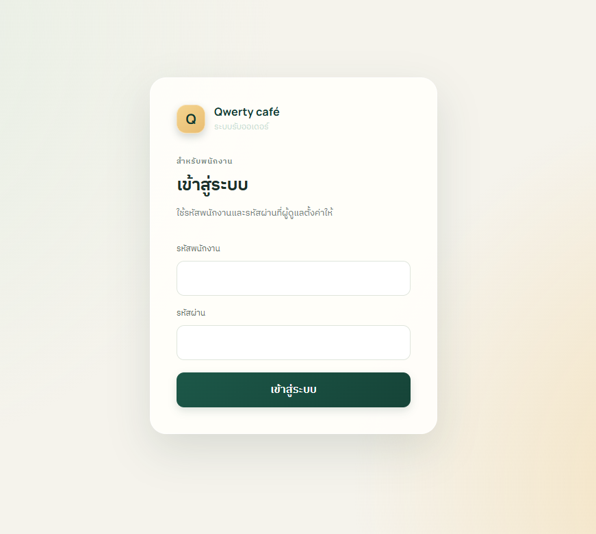
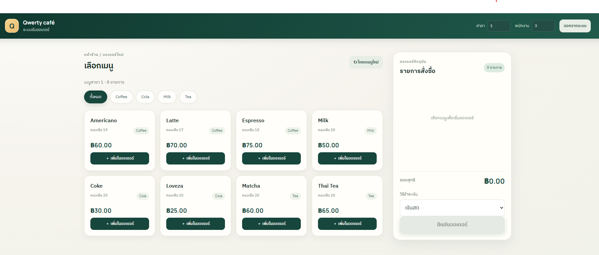
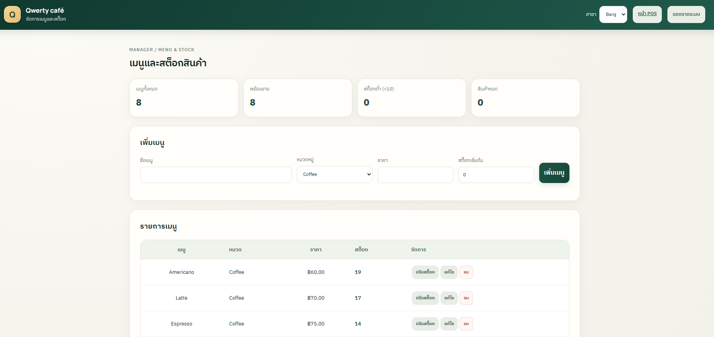
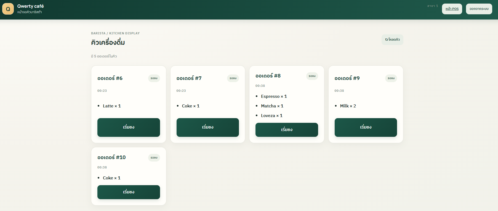
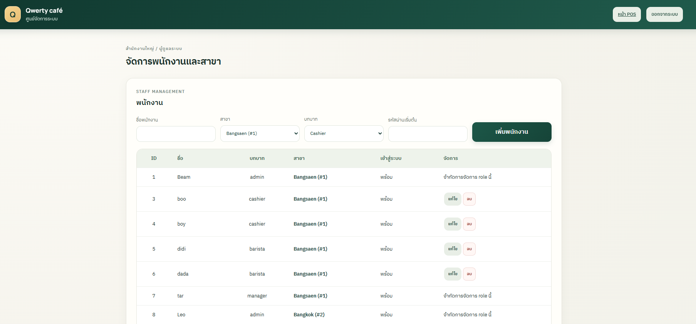
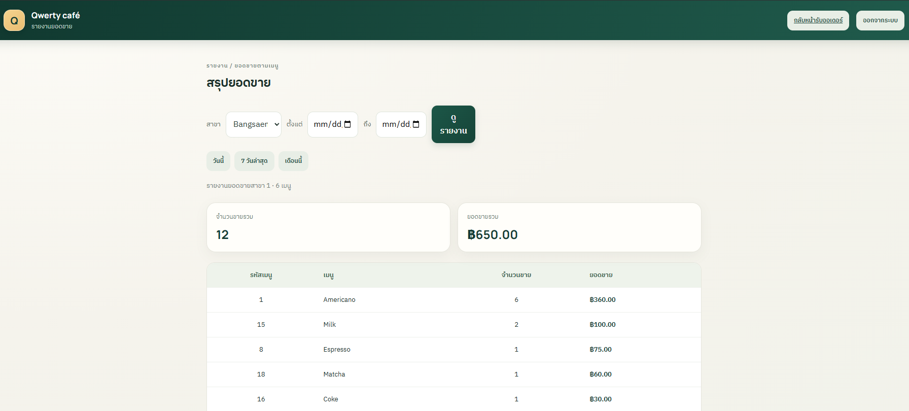

# ☕ Qwerty café POS & Smart Inventory System

ระบบขายหน้าร้านและจัดการสต็อกร้านกาแฟหลายสาขา พัฒนาด้วย Node.js, Express และ MySQL มีหน้าใช้งานสำหรับขายสินค้า จัดการเมนูและสต็อก จัดการพนักงาน ติดตามคิวบาริสต้า และดูรายงานยอดขาย

## สารบัญ

- [ความสามารถ](#ความสามารถ)
- [ภาพตัวอย่างระบบ](#ภาพตัวอย่างระบบ)
- [เทคโนโลยี](#เทคโนโลยี)
- [เริ่มต้นใช้งาน](#เริ่มต้นใช้งาน)
- [บัญชีผู้ใช้และบทบาท](#บัญชีผู้ใช้และบทบาท)
- [API หลัก](#api-หลัก)
- [โครงสร้างโปรเจกต์](#โครงสร้างโปรเจกต์)
- [เอกสารและรายงาน](#เอกสารและรายงาน)
- [ข้อจำกัดปัจจุบัน](#ข้อจำกัดปัจจุบัน)
- [สมาชิกกลุ่ม 19](#สมาชิกกลุ่ม-19)

## ความสามารถ

- **POS:** เลือกเมนู เพิ่ม/นำรายการออกจากตะกร้า คำนวณยอด และสร้างออเดอร์
- **เมนูและสต็อก:** เพิ่ม แก้ไข และลบเมนู ปรับจำนวนสินค้า และตรวจสินค้าคงเหลือน้อย
- **จัดการสาขาและพนักงาน:** เพิ่ม/แก้ไขสาขา จัดการข้อมูลพนักงานและตั้งรหัสผ่าน
- **Barista KDS:** ดูคิวและอัปเดตสถานะ `pending → preparing → ready → completed`
- **รายงานยอดขาย:** กรองตามสาขาและช่วงวันที่ พร้อมตัวเลือกช่วงเวลาที่ใช้บ่อย
- **ความปลอดภัย:** ตรวจ session และสิทธิ์ที่ API แยกข้อมูลตามสาขา ใช้ parameterized SQL และสร้างออเดอร์พร้อมควบคุมสต็อกใน transaction

## ภาพตัวอย่างระบบ

### 1. หน้าเข้าสู่ระบบ

เข้าสู่ระบบด้วยรหัสพนักงานและรหัสผ่าน



### 2. หน้าขายสินค้า

เลือกเมนูและตรวจสอบรายการในออเดอร์ก่อนยืนยัน



### 3. หน้าจัดการเมนูและสต็อก

ดูเมนูคงเหลือ เพิ่มเมนู แก้ไขข้อมูล และปรับสต็อก



### 4. หน้าคิวบาริสต้า

ตรวจรายการที่ต้องเตรียมและอัปเดตสถานะของออเดอร์



### 5. หน้าจัดการผู้ดูแล

จัดการบัญชีพนักงานและข้อมูลสาขา



### 6. หน้ารายงานยอดขาย

ตรวจสอบยอดขายของสาขาตามช่วงวันที่



## เทคโนโลยี

- Node.js 18 ขึ้นไป
- Express 5
- MySQL 8 หรือรุ่นที่รองรับ InnoDB
- `mysql2/promise` สำหรับเชื่อมต่อฐานข้อมูล
- HTML, CSS และ JavaScript สำหรับหน้าเว็บ

## เริ่มต้นใช้งาน

### สิ่งที่ต้องมี

- Node.js และ npm
- MySQL Server และ MySQL Workbench (หรือเครื่องมือจัดการ MySQL อื่น)

### 1. ติดตั้ง dependencies

เปิด PowerShell ในโฟลเดอร์โปรเจกต์ แล้วรัน:

```powershell
npm install
```

### 2. สร้างฐานข้อมูล

ใน MySQL Workbench สร้าง schema สำหรับระบบ:

```sql
CREATE DATABASE cafe_pos
  CHARACTER SET utf8mb4
  COLLATE utf8mb4_unicode_ci;
```

เลือก schema `cafe_pos` แล้วเปิดและรันไฟล์ SQL ตามลำดับ:

1. `schema.sql`
2. `docs/wk14-auth-schema.sql`
3. `docs/wk15-group19-modules.sql`

ไฟล์แรกสร้างตารางหลัก ส่วนไฟล์ถัดไปเพิ่มตาราง session/รหัสผ่านและสถานะคิวออเดอร์

### 3. ตั้งค่าการเชื่อมต่อ

สร้าง `.env` จากตัวอย่าง แล้วแก้ค่าให้ตรงกับ MySQL ในเครื่อง:

```powershell
Copy-Item .env.example .env
```

ตัวแปรที่ใช้:

| ตัวแปร | ความหมาย | ค่าในตัวอย่าง |
|---|---|---|
| `DB_HOST` | ที่อยู่ MySQL | `localhost` |
| `DB_USER` | ผู้ใช้ MySQL | `root` |
| `DB_PASSWORD` | รหัสผ่าน MySQL | กำหนดเองใน `.env` |
| `DB_NAME` | ชื่อ schema | `cafe_pos` |
| `PORT` | พอร์ตของเว็บ/API | `3101` |

อย่า commit ไฟล์ `.env` หรือใส่รหัสผ่านจริงไว้ใน repository

### 4. เตรียมข้อมูลและบัญชีเริ่มต้น

schema ที่ให้มาเป็นโครงสร้างตารางและไม่มีบัญชีผู้ใช้เริ่มต้น ต้องเตรียมสาขา หมวดหมู่ เมนู และพนักงานในฐานข้อมูลก่อนใช้งาน

บัญชีแรกที่ใช้เข้าสู่ระบบต้องมีข้อมูลพนักงานใน `employee` พร้อม `role = 'admin'` และมี password hash ใน `employee_auth` รูปแบบ hash ใช้ `scrypt` ตามที่ระบบตรวจสอบ หากมีบัญชีพนักงานอยู่แล้ว สามารถกำหนดผู้ดูแลใน MySQL Workbench ได้ เช่น:

```sql
UPDATE employee
SET role = 'admin'
WHERE employee_id = 1;
```

เปลี่ยน `1` เป็น Employee ID ที่ต้องการ และตรวจให้บัญชีดังกล่าวมีรหัสผ่านใน `employee_auth` ก่อนล็อกอิน เมื่อเข้าสู่ระบบด้วย admin ได้แล้ว สามารถจัดการพนักงานและสาขาผ่านหน้า Admin

### 5. เริ่มระบบ

```powershell
npm start
```

เมื่อ console แสดงว่าเชื่อมต่อ MySQL สำเร็จ ให้เปิด:

```text
http://localhost:3101/login.html
```

ถ้าเปลี่ยน `PORT` ใน `.env` ให้ใช้พอร์ตนั้นแทน `3101` หน้าแรกของระบบอยู่ที่ `/` และหน้าใช้งานแต่ละบทบาทต้องล็อกอินก่อน

## บัญชีผู้ใช้และบทบาท

| บทบาท | หน้าที่หลัก | หน้าเว็บ |
|---|---|---|
| `admin` | จัดการพนักงานและสาขา | `/admin.html` |
| `manager` | จัดการเมนู/สต็อก ดูออเดอร์และรายงานในสาขา | `/menu.html`, `/reports.html` |
| `cashier` | รับออเดอร์และทำรายการขายในสาขาที่ผูกกับบัญชี | `/` |
| `barista` | ดูคิวและอัปเดตสถานะเครื่องดื่ม | `/barista.html` |

หน้าจัดการพนักงานสร้างบัญชี `cashier` หรือ `barista` พร้อมรหัสผ่าน ส่วนบัญชี `manager` และ `admin` ต้องกำหนดโดยผู้ดูแลฐานข้อมูล การอนุญาต API และ branch scope ตรวจที่ฝั่ง server

## API หลัก

API ที่ต้องยืนยันตัวตนใช้ session cookie จากการล็อกอิน ยกเว้นเส้นทาง auth ที่ใช้สร้างหรือตรวจ session

| Method | Endpoint | รายละเอียด |
|---|---|---|
| `POST` | `/api/auth/login` | เข้าสู่ระบบด้วย Employee ID และรหัสผ่าน |
| `GET` | `/api/auth/session` | ตรวจ session ปัจจุบัน |
| `POST` | `/api/auth/logout` | ออกจากระบบ |
| `GET` | `/api/menu?branchId=1` | ดูเมนูของสาขา |
| `POST` | `/api/orders` | สร้างออเดอร์และตัดสต็อก |
| `GET` | `/api/orders?branchId=1` | ดูออเดอร์ของสาขา |
| `PATCH` | `/api/menu/:id` | แก้ไขข้อมูลเมนูบางรายการ |
| `GET` | `/api/reports/sales?branchId=1` | ดูรายงานยอดขาย |
| `GET`, `POST`, `PATCH`, `DELETE` | `/api/admin/...` | จัดการพนักงานและสาขา (Admin) |

## โครงสร้างโปรเจกต์

```text
.
├── docs/
│   ├── ai-disclosure/       # บันทึกการใช้ AI
│   ├── screenshots/         # ภาพตัวอย่างหน้าเว็บ
│   ├── project-report.docx  # รายงานรวมเล่มโครงงาน (Word)
│   ├── project-report.pdf   # รายงานรวมเล่มโครงงาน (PDF)
│   └── wk01–wk15-*          # เอกสารและผลงานรายสัปดาห์
├── schema.sql               # โครงสร้างฐานข้อมูลหลัก
├── src/
│   ├── app.js               # จุดเริ่มต้น Express และการ mount routes
│   ├── config/              # การเชื่อมต่อฐานข้อมูล
│   ├── controllers/         # กฎธุรกิจและการจัดการ request
│   ├── middleware/          # Authentication และตรวจ role
│   ├── models/              # คำสั่งฐานข้อมูลและ domain models
│   ├── public/              # HTML/CSS/JavaScript ของหน้าเว็บ
│   └── routes/              # API routes
├── .env.example             # ตัวอย่างค่าตั้งต้น
├── package.json
└── README.md
```

## เอกสารและรายงาน

- [รายงานรวมเล่มโครงงาน (Word)](docs/project-report.docx)
- [รายงานรวมเล่มโครงงาน (PDF)](docs/project-report.pdf)
- [Software Requirements Specification](docs/wk10-srs.md)
- [กฎธุรกิจ](docs/wk09-business-rules.md)
- [สถาปัตยกรรมระบบ](docs/wk11-architecture.md)
- [บันทึก usability testing](docs/wk12-usability-testing.md)
- [บันทึก integration และ E2E testing](docs/wk13-integration-testing.md)
- [การยืนยันตัวตน](docs/wk14-authentication.md)
- [การตรวจคุณภาพและความปลอดภัย](docs/wk14-quality-review.md)

## ข้อจำกัดปัจจุบัน

- ตัวเลือก `cash`, `credit` และ `qr` เป็นวิธีชำระเงินที่บันทึกในระบบ ยังไม่มี payment gateway หรือ PromptPay integration
- ยังไม่มีระบบสมาชิกสะสมแต้ม ส่วนลดสมาชิก การปรับแต่งเครื่องดื่ม หรือใบเสร็จเครื่องพิมพ์ตามเอกสารขอบเขตปัจจุบัน
- ฐานข้อมูลเริ่มต้นไม่มีข้อมูลตัวอย่างและไม่มีบัญชี admin สำเร็จรูป
- ควรตั้ง HTTPS และตรวจสอบบัญชี/สิทธิ์ก่อนนำระบบออกใช้งานจริง

## สมาชิกกลุ่ม 19

| รหัสนักศึกษา | ชื่อ-นามสกุล |
|---|---|
| 67160019 | วายุ ทองแตง |
| 67160029 | ดนุพร กระจ่าง |
| 67160045 | สิรวิชญ์ เรียนรู้ |
| 67160176 | กิตติกานต์ หยุดรัตน์ |
| 67160200 | วิริทธิ์พล พูลแพ |
