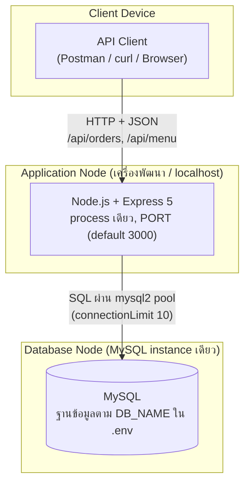
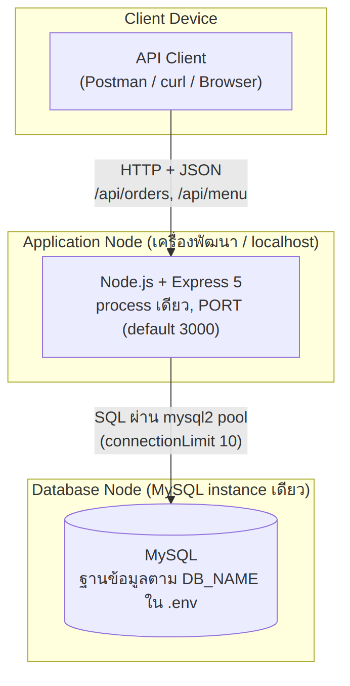
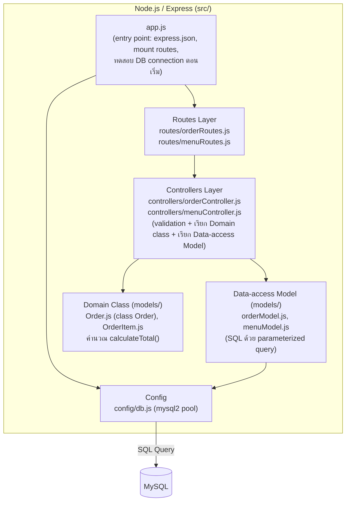

# WK11 Workshop — Architecture Diagram (4+1 View Model)

**กลุ่ม 19 — Cafe POS** | ตรวจสอบจาก repository จริง (`cafe-pos-group19-main`)

---

## 1. Physical View (Deployment Topology)

ตรวจจากโค้ดจริง: `src/app.js` รัน Express process เดียว (พอร์ตจาก `process.env.PORT` ค่าเริ่มต้น `3000`) และเชื่อม MySQL ผ่าน `mysql2/promise` connection pool (`src/config/db.js`, `connectionLimit: 10`) โดยอ่านค่าเชื่อมต่อจาก `.env` (`DB_HOST`, `DB_USER`, `DB_PASSWORD`, `DB_NAME`)

ใน repo **ไม่มี** ไฟล์ frontend (HTML/React) และ `app.js` ไม่ได้ serve static file — ฝั่ง Client จึงเป็นผู้เรียก REST API (เช่น Postman/curl/เบราว์เซอร์) ไม่ใช่หน้าเว็บที่ระบบ host เอง

**หมายเหตุ:**
- มี Database Server เพียงชุดเดียว สาขาแยกด้วยคอลัมน์ `branch_id` (ตาราง `branch`, `employee`, `menu_item`, `orders`) ไม่ได้แยกเซิร์ฟเวอร์ตามสาขา
- ไม่มี load balancer, cache, หรือ service อื่นใน deployment จริง

---

## 2. Development View (Component / Module Decomposition)

ใช้ **เวอร์ชัน (ก)** เพราะ repo มี data-access model แยกไฟล์แล้ว (`menuModel.js`, `orderModel.js`) ไฟล์ทั้งหมดใน `src/` ตรวจแล้วว่ามีอยู่จริง:

### Component ที่มีอยู่จริง

| Layer | ไฟล์ | หน้าที่ |
|---|---|---|
| Entry | `src/app.js` | สร้าง Express app, mount `/api/orders` และ `/api/menu`, ตรวจการเชื่อมต่อ DB ตอนเริ่ม |
| Routes | `orderRoutes.js` | `POST /` (สร้างออเดอร์), `GET /` (ดูออเดอร์ทั้งหมด) |
| Routes | `menuRoutes.js` | CRUD เมนู: `GET /`, `GET /:id`, `POST /`, `PUT /:id`, `DELETE /:id` |
| Controller | `orderController.js` | validate input, ตรวจสต็อก, ใช้ `Order`/`OrderItem` คำนวณยอดรวมจากราคาใน DB, ตัดสต็อก, คืน `totalAmount` และ `lowStockMenuIds` (สต็อก < 10) |
| Controller | `menuController.js` | validate `branchId`/`price`/`stockQuantity` ก่อนเรียก model ทุก endpoint (กัน IDOR ด้วย `menu_id` + `branch_id`) |
| Data-access | `menuModel.js` | `findAllByBranch`, `findByIdAndBranch`, `findManyForStockCheck`, `create`, `updateFields`, `remove`, `deductStock` |
| Data-access | `orderModel.js` | `create`, `addItem`, `findAll` |
| Config | `config/db.js` | mysql2 connection pool |
| Domain | `Order.js`, `OrderItem.js` | คลาสตาม Class Diagram wk06 ถูกใช้ใน `createOrder` เพื่อคำนวณ `totalAmount` |

### ข้อจำกัดปัจจุบันของโค้ด (ระบุตามหัวข้อ 3.4 ข้อ 5)

1. **ไม่มี database transaction** ใน `createOrder` — ขั้นตอน `orderModel.create` → `addItem` → `deductStock` รันเป็น query แยกกัน หากล้มเหลวกลางทางอาจได้ออเดอร์ค้างหรือสต็อกไม่ตรง และการตรวจสต็อกกับตัดสต็อกไม่ได้ lock แถว (มี race condition ได้เมื่อมีหลาย request พร้อมกัน)
2. **ยังไม่มี Reports module** — wk10 ออกแบบ `GET /api/reports/sales` ไว้แล้ว (เอกสาร/Sequence Diagram) แต่ยังไม่มี `reportRoutes.js` / `reportController.js` ใน `src/` จึง**ไม่**วาดอยู่ใน diagram ข้างบน (เป็นแผนในอนาคต)
3. **ตาราง `stock_movement` มีใน `wk07-schema.sql` แต่ไม่มีโค้ดใช้งาน** — การตัดสต็อกอัปเดต `menu_item.stock_quantity` โดยตรง ไม่ได้บันทึกประวัติ

---

## 3. สรุปสถาปัตยกรรม

ระบบ Cafe POS ของกลุ่ม 19 ใช้สถาปัตยกรรมแบบ **Monolithic + Layered** เพราะ deploy เป็น Node.js/Express process เดียว (พอร์ต `PORT` ค่าเริ่มต้น 3000) ที่รวม routing, business logic และ data access ไว้ใน repository เดียว และเชื่อมกับ MySQL เพียงฐานเดียวผ่าน connection pool โครงสร้างภายในแบ่งเป็น `routes` → `controllers` → `models` (data-access) → `config/db` ตามที่วางไว้ตั้งแต่สัปดาห์ 5 โดยแต่ละ layer สื่อสารกับ layer ถัดไปเท่านั้น (route ไม่เรียก model ตรง)

ทีมมีสมาชิกจำนวนน้อยและเวลาพัฒนาจำกัด ขอบเขตระบบจึงอยู่ที่ฟีเจอร์เมนู (CRUD ต่อสาขา) และการสั่งซื้อ/ตัดสต็อก ซึ่งยังไม่จำเป็นต้องแยกเป็น service อิสระ — การแก้ไขแต่ละฟีเจอร์ทำภายใน repo เดียว ไม่ต้องประสานข้าม service และยังได้ประโยชน์เรื่อง separation of concerns จากการแบ่ง layer แนวคิดหลายสาขาจำลองด้วย `branch_id` ในฐานข้อมูลเดียว ไม่มีการ sync ข้อมูลข้ามเซิร์ฟเวอร์

ข้อจำกัดปัจจุบันที่ diagram ไม่ได้ซ่อน: `createOrder` ยังไม่ใช้ transaction และส่วนรายงานยอดขายยังอยู่ในขั้นออกแบบ

---

## 4. 4+1 View Mapping (อ้างอิงเอกสารที่ส่งแล้ว)

| View | เอกสารของกลุ่ม |
|---|---|
| Scenarios | Use Case Diagram (wk04) |
| Logical | `wk06-class-diagram.png`, `wk06-object-diagram.png` |
| Process | `wk09-Sequence-Diagram.png`, `wk09-flowchart.png` |
| Development | หัวข้อ 2 ของไฟล์นี้ |
| Physical | หัวข้อ 1 ของไฟล์นี้ |
